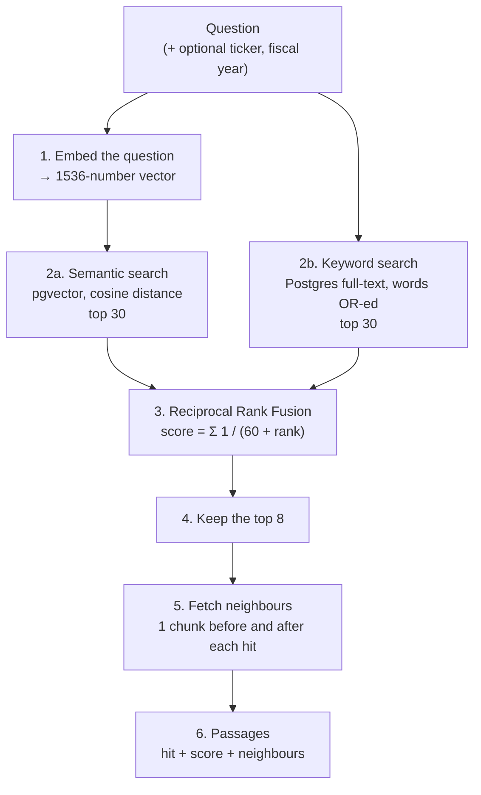

# Retrieval

Turns a question into the most relevant passages from the SEC filings.

It runs two searches (by **meaning** and by **keywords**), merges their rankings, and returns the best passages together with the chunks around them.

## How it works



2a and 2b run at the same time. Everything else runs in order.

## Files

| File | Job |
| ---- | --- |
| `retriever.py` | `retrieve()`: runs the steps above and returns `Passage` objects |
| `queries.py` | The three SQL reads: `semantic_search`, `keyword_search`, `get_chunks` |
| `fusion.py` | `reciprocal_rank_fusion()`: merges ranked lists, no database involved |

Related: `app/embeddings.py` embeds the question; `app/database/engine.py` gives the SQL connection.

## Default parameters

All defaults live in `app/config.py` (class `Settings`). Override any of them with an env var of the same name in upper case, e.g. `RETRIEVAL_TOP_K=10`.

`retrieve(engine, embedding_client, query, *, top_k, candidates, neighbor_window, ticker, fiscal_year)`: a size left as `None` uses the setting below.

| Setting | Default | Meaning |
| ------- | ------- | ------- |
| `retrieval_top_k` | **8** | Passages returned after fusion |
| `retrieval_candidates` | **30** | How many chunks each search returns before fusion |
| `retrieval_neighbor_window` | **1** | Chunks added on each side of a hit (0 = none) |
| `retrieval_rrf_k` | **60** | Smoothing constant in `1 / (k + rank)` |
| `keyword_ignore_words` | ~50 words | Filler and generic filing words the keyword search skips (e.g. "tell", "company", "10-K") |

`ticker` and `fiscal_year` default to none (search everything).

**Ignored words.** Postgres already drops English stopwords (the, of, was...). `keyword_ignore_words` adds request filler ("please", "describe", "summarize") and words present in nearly every filing ("company", "filing", "annual"). Matching them says nothing about relevance, so they would only add noise to the keyword ranking. They affect the keyword search only; the semantic search still sees the whole question. Add a word to the list in `config.py` when you see it pulling in irrelevant chunks.

## How many chunks come back

| Stage | Chunks |
| ----- | ------ |
| Semantic search | up to 30 (always 30 unless filters leave fewer) |
| Keyword search | up to 30 (fewer, or none, if few chunks contain the query words) |
| After fusion | up to 60 distinct; the **top 8 are kept** |
| Neighbours | up to 2 per hit → up to **16** more |
| **Returned to the caller** | **8 passages, up to 24 chunks in all** |

Chunks are at most 512 tokens (about 380 on average in the current corpus), so the worst case is roughly 12,000 tokens of context. The corpus holds 40 filings (8 companies × 5 years) in 11,240 chunks.

## Details worth knowing

- **Semantic search** orders every embedded chunk by cosine distance to the question vector, using the HNSW index.
- **Keyword search** OR-s the question's words (`iPhone | revenue`) and ranks chunks with `ts_rank_cd`, so chunks matching more words come first. Only letters and digits are kept, so user text cannot inject query syntax.
- **Fusion** uses ranks, never raw scores, because vector distances and text ranks are on different scales. A chunk found by both searches beats one found by only one. The best possible score is 2/61 ≈ 0.033.
- **Neighbours** carry no score. They exist so a table or explanation that spans several chunks is not cut off.
- **Filters** apply to both searches. A filing's ticker and fiscal year are read from each chunk's `chunk_metadata`.

## Known limits

- **Unfiltered, cross-company questions** can be dominated by the company with the most chunks (JPMorgan has several times more than the others). Pass a `ticker`, or search each company separately and compare.
- **Filtered semantic search** goes through an approximate index. If a filter matches a small share of the table, the index may return fewer than `candidates` rows. Check this if filtered searches look thin.
- **No re-ranking.** The order is the fused order; there is no cross-encoder or LLM re-ranker.

## Try it

```bash
cd backend
uv run python scripts/try_retrieval.py "How much revenue came from data center?" --ticker NVDA
uv run pytest tests/retrieval -q
```
